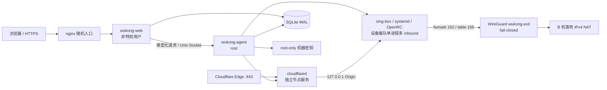

# 悟空面板 (Wukong Panel)

悟空面板是面向个人与小型团队的自治 VPS 节点控制台。可在任一面板启用中央主控，将本机与 2–10 台远端主机的节点生命周期、分享订阅、实时速率、主机状态和整机流量账期汇聚在同一个安全界面中。


## 宣传片 | Product Film

https://github.com/user-attachments/assets/a66e91b8-70e7-401b-99b3-439cc35217d2

---

## 核心特性

- **中央舰队与多机管控**：任一面板可纳管本机及最多 10 台远端 VPS；支持卡片实时网络速率监控、节点统一调度、跨机合并订阅与无损平滑切换。
- **轻量探针零开销**：无面板小鸡可独立安装极简无状态的 `wukong-probe` 单二进制，上报资源与网络质量；中央主控自动托管账期流量配额与到期时间，防重启计数归零接续累计。
- **七大主流协议驱动**：深度支持 Hysteria 2、VLESS + REALITY、VLESS + WS + Cloudflare Tunnel、Shadowsocks 2022、TUIC v5、Trojan TLS 与 AnyTLS，支持本机双栈闭环握手自检。
- **设备编队与批量管理**：首创设备专用节点入口，一个进程、一个配置统一管理 2–20 台设备的独立入站端口与凭据；支持双 VPS 落地 IP 出口与 fail-closed 路由保护。
- **出站安全与零公网暴露**：远端 Agent 仅通过证书可信 HTTPS 主动发起连接长轮询，不开放额外端口、不使用 SSH；非特权 Web 服务与 root Agent 通过受限 Unix Socket 严格隔离。
- **全链路网络质量观测**：按国际与国内分组，实时采集 ICMP 延迟与丢包率，直观呈现近 30 分钟历史走势，支持故障自动切换备用目标。
- **安全变更与无损接管**：自动扫描导入既有 `/etc/s-box` 与 systemd 服务，配置变更失败秒级自动回滚；自动申请与每日续期 ACME 证书。

---

## 快速开始

支持 Debian、Ubuntu、Rocky Linux、AlmaLinux、Alpine；支持 `amd64`、`arm64`。

### 1. 一键安装完整面板

```bash
curl -fsSL https://github.com/252201/wukong-panel/releases/latest/download/install.sh | sudo sh
```

纯净 VPS 如果没有预装 `curl`，可直接使用 `wget` 快速入口：
```bash
wget -qO- https://github.com/252201/wukong-panel/releases/latest/download/bootstrap.sh | sudo sh
```

### 2. 接入轻量探针

在中央主控面板进入“中央多机控制”并点击“接入轻量探针”，复制页面生成的 10 分钟一次性命令并在目标 VPS（root 权限）执行即可。探针仅消耗数 MB 内存，不安装 Web、数据库或 sing-box。

### 3. 常用运维与更新

```bash
# 安全更新到最新版本（保留现有配置、证书与节点）
curl -fsSL https://github.com/252201/wukong-panel/releases/latest/download/install.sh | sudo sh -s -- --update

# 固定版本、自定义端口与访问路径
sudo sh install.sh --version v2.0.8 --port 9443 --base-path /my-secret-panel/

# 忘记管理员密码：撤销现有会话并生成一次性临时登录密码
curl -fsSL https://github.com/252201/wukong-panel/releases/latest/download/install.sh | sudo sh -s -- --reset-password
```

<details>
<summary><b>查看更多安装与高级配置参数（证书/防火墙/排障）</b></summary>

```bash
# 临时接管 80 端口用于 Let's Encrypt HTTP-01 验证（验证后自动恢复原服务）
sudo sh install.sh --domain panel.example.com --acme http --email admin@example.com --takeover-port-80

# 使用已有证书
sudo sh install.sh --domain panel.example.com --cert-file /path/fullchain.cer --key-file /path/private.key

# Cloudflare DNS-01 自动证书
sudo -E env CF_Token=... CF_Zone_ID=... sh install.sh --domain panel.example.com --acme cloudflare

# 防火墙状态与管理
sudo sh install.sh --firewall-status
sudo sh install.sh --firewall-on
sudo sh install.sh --firewall-open 45080/udp,34001/tcp
sudo sh install.sh --firewall-off

# 停止或启动面板服务（保留 Nginx 入口与开机自启）
sudo sh install.sh --stop-panel
sudo sh install.sh --start-panel

# 卸载面板（默认保留节点数据；--purge 彻底清理自身数据）
sudo sh install.sh --uninstall
sudo sh install.sh --uninstall --purge
```
</details>

---

## 中央舰队与全局订阅

在主控面板进入“设置 → 中央多机控制”配置主控：

| 设置项 | 用途 | 示例 |
| --- | --- | --- |
| **主控通信地址** | 远端 Agent 接入、心跳与命令长轮询 | `https://panel.example.com/wukong-abc123/` |
| **订阅公开地址** | 客户端拉取中央全局订阅（推荐标准 443 入口） | `https://sub.example.com/` |

在远端 VPS 以 root 运行主控生成的接入命令：
```bash
curl -fsSL https://github.com/252201/wukong-panel/releases/latest/download/install.sh \
  | sudo sh -s -- \
      --join-controller 'https://panel.example.com/wukong-abc123/' \
      --enrollment-token '10分钟一次性令牌' \
      --host-name '东京-02'
```

---

## 主机安全防护

面板“安全 / Security”页深度集成了各发行版原生防火墙（UFW / firewalld / nftables）与 Fail2ban SSH 防暴破保护：
- **安全变更防锁死**：高危规则变更需在 90 秒内确认，超时或断线自动回滚。
- **端口自动识别**：智能识别当前 SSH 监听端口并默认放行，精准保护出入站安全。
- **SSH 动态封禁**：可视化查看封禁名单、日志及白名单设置，支持一键解封。
- 详细说明与规则规范见 [主机安全管理指南](docs/host-security.md)。

---

## 架构设计与安全边界



- **凭据加固**：用户密码使用 Argon2id 哈希计算，节点密钥采用 AES-256-GCM 加密，机器密钥文件严格限制权限为 `0600`。
- **会话防护**：会话 Cookie 设置 `Secure`、`HttpOnly`、`SameSite=Strict`，所有写操作强制校验 CSRF。
- **最小特权**：Web 前端以非特权用户运行，Root Agent 仅接受类型化固定动作指令，杜绝任意 Shell 注入。

---

## 进阶指南与文档

- 📘 [Cloudflare Tunnel 节点与设备编队指南](docs/cloudflare-tunnel.md)
- 🌐 [双 VPS 落地 IP 出口配置指南](docs/residential-exit.md)
- 🛡️ [主机安全与防火墙说明](docs/host-security.md)
- 📦 [sing-box 生命周期与平滑迁移](docs/sing-box-management.md)
- 💻 [CLI 命令行工具与 RESTful API 指南](docs/cli-and-api.md)

---

## 本地开发

```bash
# 1. 编译前端
cd web && npm install && npm run build && cd ..

# 2. 运行测试与构建后端
go test ./...
go build -o build/wukong-panel ./cmd/wukong-panel

# 3. 启动演示环境
./build/wukong-panel serve \
  --listen 127.0.0.1:8788 \
  --data-dir /tmp/wukong-demo \
  --config-dir /tmp/wukong-sbox \
  --base-path / --secure-cookie=false --demo
```

---

## License

MIT
